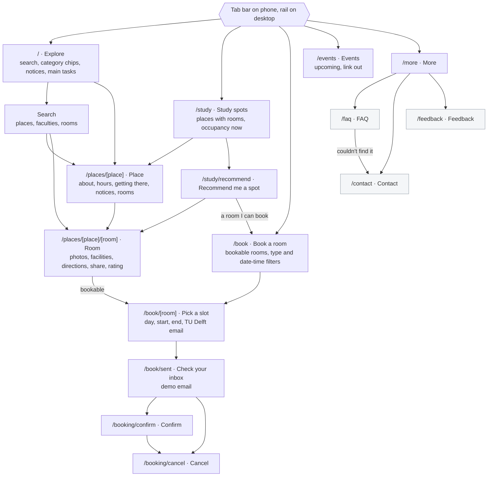
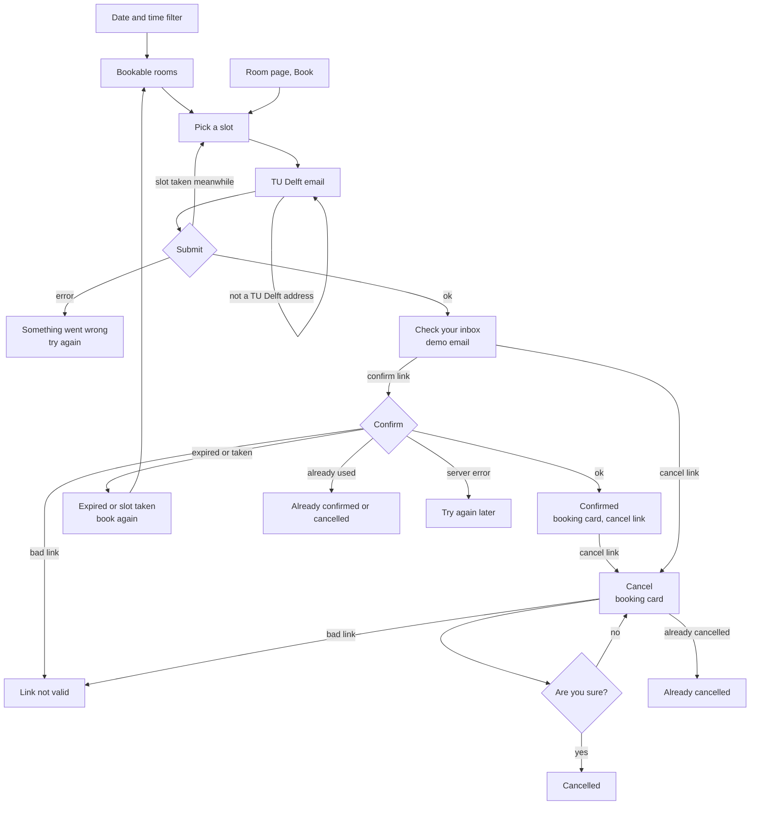
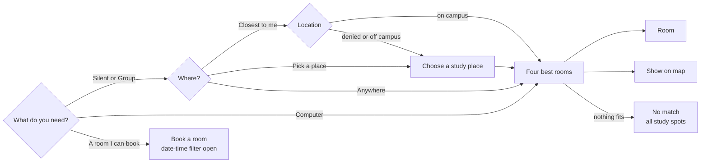

# Information architecture

Status: built · 2026-11-18

Screens, routes and flows. What each feature does is in [features.md](features.md).

## Decisions

- **The campus is the canvas.** Screens open as a sheet (phone) or side panel (desktop) over the 3D campus, and the camera follows what's open. FAQ, contact and feedback have nothing to show on the map, so on phone they open full screen.
- **Five tabs:** Explore, Study, Book, Events, More. Rejected: studypleq's seven-item hamburger menu, which hides the main tasks behind a tap.
- **A place is one page.** The Library has one page, and its rooms live on it. Rejected: separate study-spot and booking pages for the same room, as studypleq had.
- **Categories from the card sort, with three fixes:** a place can sit in two categories, faculties are found by search instead of a category, and the services desk gets its own group.
- **State lives in the URL:** selected place, filters, recommend step, booking slot. Back works and links can be shared.

## Places and categories

| #   | Place                             | Categories                     | Rooms                   |
| --- | --------------------------------- | ------------------------------ | ----------------------- |
| 1   | TU Delft Library                  | Study spots, Help and services | Yes, some bookable      |
| 2   | Aula Conference Centre            | Eat and drink, Campus life     | No                      |
| 3   | Pulse                             | Study spots                    | Yes, some bookable      |
| 4   | Echo                              | Study spots                    | Yes                     |
| 5   | EEMCS (EWI) high-rise             | Search only (faculty)          | No                      |
| 6   | Faculty of Architecture (BK City) | Search only (faculty)          | No                      |
| 7   | X (sports and culture centre)     | Campus life                    | No                      |
| 8   | Science Centre Delft              | Campus life                    | No                      |
| 9   | TU Delft Botanical Garden         | Campus life                    | No                      |
| 10  | Mekelpark                         | Campus life                    | No                      |
| 11  | Delft Centraal                    | Getting here                   | No, edge marker         |
| 12  | Tram 19 campus stops              | Getting here                   | No, one marker per stop |
| 13  | Bike parking (Library, Aula)      | Getting here                   | No, one marker per lot  |
| 14  | Faculty canteens and campus cafés | Eat and drink                  | No, one marker each     |
| 15  | Student and Campus Services desk  | Help and services              | No                      |

Which rooms are bookable is set in the mock data. Faculties show on the map with every chip off, like all other places. Tram stops always show as markers; bike parking and cafés show when their category is on or the place is open.

## Layout

- **Phone:** tab bar at the bottom. The sheet has three heights: peek (title only), half (campus and panel share the screen) and full. Dragging it down shows more campus.
- **Desktop:** a rail on the left with the five tabs, a panel of about 400 px next to it, the campus fills the rest.
- **Both:** selecting a place, on the map or in a list, opens its panel and moves the camera. Closing the panel returns to the tab's root.

## Sitemap

Grey: full-screen pages on phone, no map. Everything else opens over the campus.

## Booking flow

## Recommend flow

